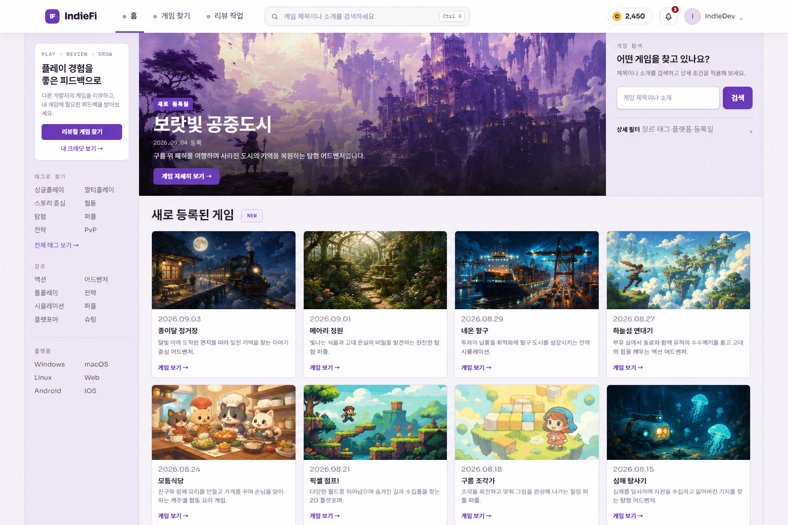
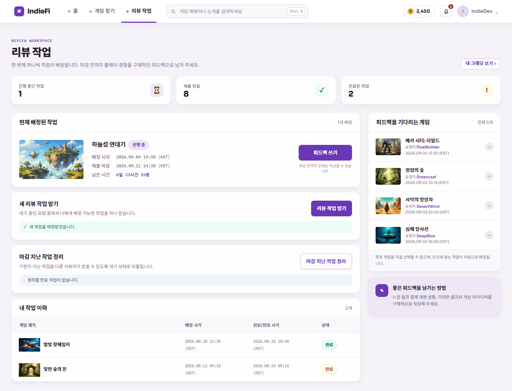
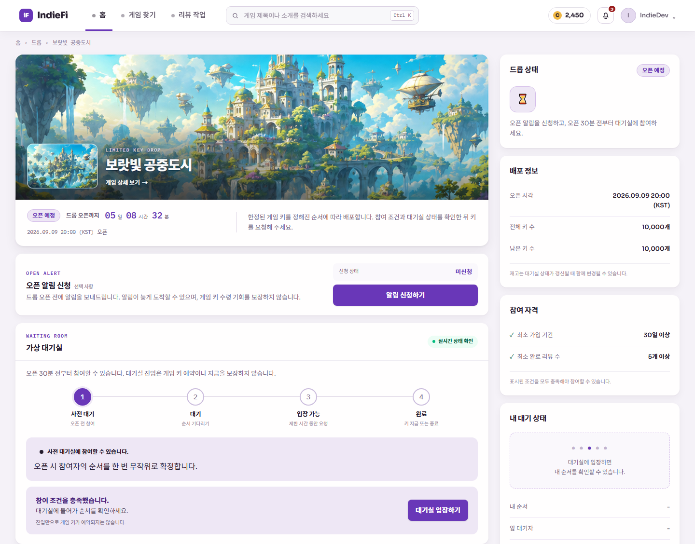
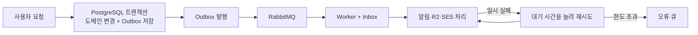
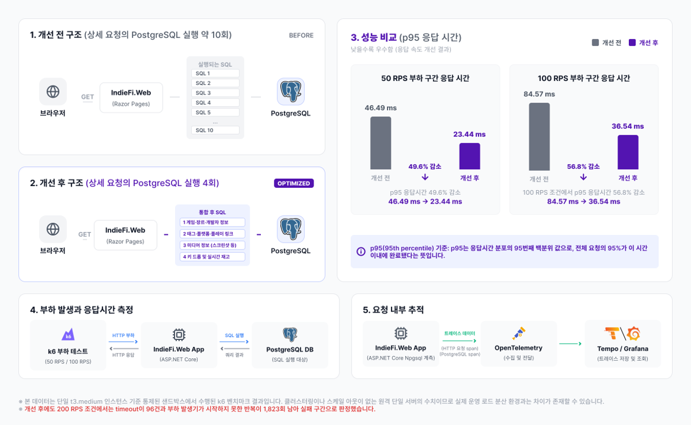
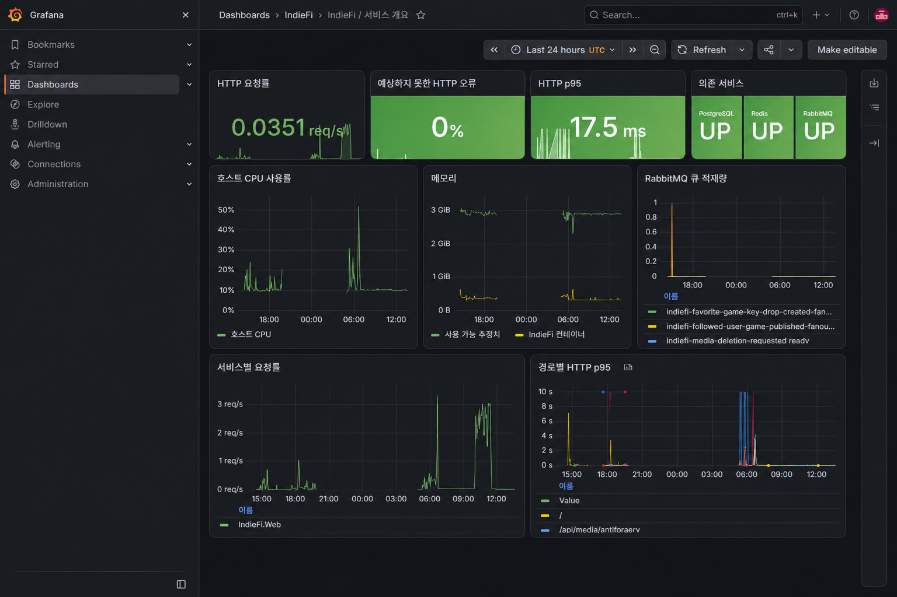
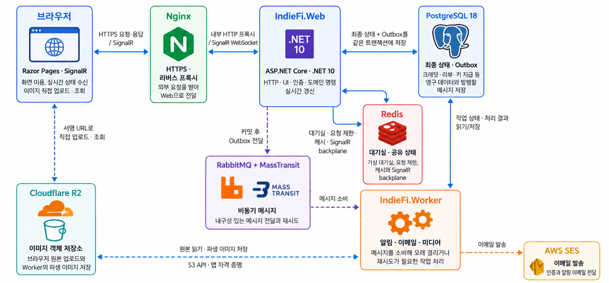

# IndieFi

> IndieFi는 인디 게임 개발자들이 서로 플레이테스트를 하고 피드백을 받을 수 있도록 만든 웹 서비스 프로젝트입니다.

**바로가기**

- [핵심 기능과 설계](#핵심-기능과-설계) · [검증과 운영](#검증과-운영)
- [아키텍처와 기술 스택](#아키텍처와-기술-스택)
- [프로젝트 구조](#프로젝트-구조) · [로컬 실행](#로컬-실행)

<details>
<summary><strong>프로젝트 배경 및 문제 상황</strong></summary>

최근에는 AI를 포함한 제작 도구가 발전하면서 개인과 소규모 팀도 게임 제작에 도전하기 쉬워졌습니다. [SteamDB 집계](https://steamdb.info/stats/releases/)에서 Steam의 연간 게임 출시 수는 2019년 8,063개에서 2024년 18,468개, 2025년 21,318개로 증가했습니다. 더 많은 게임이 만들어지는 만큼 하나의 게임이 플레이어에게 발견되고, 출시 전에 충분히 검증받기는 어려워지고 있습니다.

특히 인디 개발자는 제한된 인력과 비용 안에서 플레이테스트 참가자 모집, 버그와 사용성 확인, 객관적인 피드백 수집과 초기 홍보까지 직접 해결해야 합니다. [Gamedev.js 2024 설문](https://gamedevjs.com/survey/2024/)에서도 응답자의 93.3%가 직접 게임을 테스트했지만 자체 QA 팀이 있다는 응답은 10.3%에 불과했습니다. [인디 개발자 대상 플레이테스트 연구](https://eprints.whiterose.ac.uk/id/eprint/216480/)에서도 적절한 참가자를 찾고 피드백 데이터를 다루는 문제가 주요 어려움으로 확인됐습니다.

IndieFi는 이 중 **출시 전 플레이테스터와 피드백을 확보하는 문제**에 집중했습니다. 다른 게임을 리뷰해 얻은 크레딧으로 자신의 게임에 리뷰를 요청하고, 게임 소개·검색과 한정 게임 키 배포를 통해 초기 플레이어와 만날 수 있도록 구성했습니다.

</details>

`C#` · `.NET 10` · `ASP.NET Core` · `PostgreSQL 18` · `Redis` · `RabbitMQ` · `OpenTelemetry`



> **현재 공개 서버는 중지된 상태입니다.**

## 핵심 기능과 설계

### 1. 크레딧 기반 피드백 교환

**다른 게임 리뷰** → **크레딧 획득** → **내 게임의 리뷰 요청** → **리뷰어 자동 배정** → **피드백 수령**

1. 다른 개발자의 게임을 리뷰하면 자신의 게임에 피드백을 요청할 때 사용할 크레딧을 받습니다.
2. 크레딧을 사용한 요청은 오래 기다린 순서와 배정 조건에 따라 다른 리뷰어에게 자동으로 배정됩니다.
3. 리뷰가 기한 안에 끝나지 않으면 다시 대기 상태로 돌아가며, 요청을 취소하면 사용한 크레딧을 돌려받습니다.



*진행 중인 작업과 완료·만료 이력, 피드백을 기다리는 요청을 보여주는 로컬 샘플 화면입니다.*

| 지켜야 할 조건 | 적용한 설계 |
|---|---|
| 동시에 요청해도 잔액이 음수가 되지 않음 | 적립·사용·환불을 누적 기록하는 크레딧 장부, PostgreSQL 트리거와 CHECK, 잔액 직접 수정 권한 제거 |
| 차감과 리뷰 요청이 일부만 반영되지 않음 | 크레딧 차감과 요청 생성을 하나의 트랜잭션으로 처리 |
| 하나의 요청은 한 명에게만 배정됨 | `SKIP LOCKED`, 부분 UNIQUE 인덱스와 제한 시간 배정 |
| 재시도와 동시 종료가 중복 결과를 만들지 않음 | 요청 식별자와 상태·마감 시각을 이용한 조건부 갱신, 원래 차감을 참조하는 환불 기록 |

실제 PostgreSQL에서 동시 요청과 중간 실패, 반복 제출·취소와 제출·만료 경쟁을 실행해 잔액 음수와 중복 배정·지급·환불이 발생하지 않는 것을 확인했습니다. 트리거와 DB 권한은 애플리케이션 밖의 방어선인 만큼 마이그레이션과 실제 DB 통합 테스트로 함께 관리합니다.

### 2. 한정 게임 키 배포

**배포 예약** → **사용자 사전 대기** → **순차 입장** → **자격·재고 확인** → **게임 키 1회 지급**

1. 개발자는 오픈 시각과 게임 키를 등록하고 가입 기간·완료 리뷰 수 같은 참여 조건을 선택할 수 있습니다.
2. 사용자는 오픈 알림을 신청하고 30분 전부터 가상 대기실에서 자신의 순서를 확인합니다.
3. 차례가 되면 제한 시간 안에 키를 요청하며, 조건을 충족하고 재고가 남아 있으면 키 하나를 받습니다.
4. 준비한 키가 모두 지급되거나 개발자가 조기 마감하면 대기실과 지급을 종료합니다.



*현재 재고와 참여 조건, 사용자의 대기 순번을 보여주는 로컬 샘플 화면입니다.*

| 담당 상태 | 저장소 | 처리 방식 |
|---|---|---|
| 대기 순번과 짧은 입장 권한 | Redis | Lua 스크립트로 진입·승격을 원자적으로 처리하고 서버 시각·TTL·AOF 사용 |
| 키 재고와 최종 지급 결과 | PostgreSQL | 행 잠금, `FOR UPDATE SKIP LOCKED`, 사용자·키 UNIQUE와 상태 버전으로 확정 |
| Redis 장애 후 대기실 복구 | Redis + PostgreSQL | PostgreSQL의 확정된 지급 결과를 기준으로 임시 상태를 재동기화 |

단일 EC2의 60명 집중 유입에서 42회 지급 요청 중 준비한 키 36개가 정확히 지급됐고 HTTP 오류와 사용자·키 중복은 없었습니다. 100명에서도 지급 정합성은 유지됐지만 대기 상태 조회 p95가 목표 750ms를 넘어 1.291초가 됐습니다. 따라서 **응답시간 목표까지 확인한 범위는 60명**이며, Redis 자체의 최대 처리량이나 동시 수천 명을 검증한 결과로 표현하지 않습니다.

### 3. 알림과 미디어 비동기 처리

- **고려한 실패:** DB 트랜잭션 확정과 메시지 발행을 따로 수행하면 DB만 반영된 상태에서 프로세스가 종료될 수 있습니다. RabbitMQ의 최소 한 번 전달(at-least-once) 방식에서는 처리한 메시지가 다시 전달될 수도 있습니다.
- **설계 결정:** 도메인 변경과 Outbox 메시지를 같은 트랜잭션에 저장하고 Worker가 RabbitMQ로 발행합니다. 소비 측은 Inbox와 이벤트 ID로 중복을 확인하고, 실패가 반복될수록 대기 시간을 늘려 재시도한 뒤 한도를 넘은 메시지는 오류 큐로 분리합니다.



RabbitMQ·R2·SES 장애 뒤 보류 작업이 다시 처리되고 알림·미디어·이메일 상태가 중복 없이 최종 상태로 수렴하는 것을 확인했습니다. 이는 최소 한 번 전달에서 안전하게 처리하도록 만든 것이며 정확히 한 번 전달(exactly-once)을 구현했다는 의미는 아닙니다.

### 4. 계정 이메일과 게임 키 보호

DB가 유출되더라도 이메일과 게임 키 원문이 바로 노출되지 않도록, 나중에 원문이 필요한 데이터와 다시 복원할 필요가 없는 데이터를 구분했습니다.

| 데이터 | DB에 저장하는 값 | 사용할 때의 처리 |
|---|---|---|
| 계정 이메일 | AES-256-GCM 암호문 + HMAC-SHA-256 검색값 | HMAC으로 찾고 필요한 경우 복호화 |
| 게임 키 | AES-256-GCM 암호문 + HMAC-SHA-256 중복 확인값 | HMAC으로 중복을 확인하고 지급된 키만 복호화 |
| 인증·비밀번호 재설정 토큰 | 원문을 복원할 수 없는 해시 | 전달받은 토큰을 다시 해시해 저장값과 비교 |

용도마다 서로 다른 키를 사용하고 키 교체 도구를 마련했습니다. 암호화되지 않은 값이 남아 있으면 최종 마이그레이션을 중단하며, DB와 보호 키를 빈 환경에 복원해 로그인·이메일 조회와 게임 키 복호화까지 확인했습니다. 보호 키를 잃으면 데이터도 복구할 수 없으므로 데이터와 키는 분리해 백업합니다.

### 5. 게임 상세 조회 성능

- **관측:** 개선 전 공개 조회·검색 혼합 부하를 200 RPS(초당 요청 200건)까지 높였을 때 EC2 CPU가 99.99%에 도달했고, k6가 시작하지 못한 테스트 반복이 5,205건 발생했습니다.
- **분석:** 느린 게임 상세 요청의 OpenTelemetry 요청 추적에는 연관 데이터를 순서대로 조회하는 PostgreSQL 호출 구간이 약 10개 있었습니다. 이를 CPU 포화의 단일 원인으로 단정하지 않고, 측정 가능한 첫 번째 병목 후보로 선택했습니다.
- **개선:** 화면에 필요한 데이터만 선택하고 연관 조회를 합쳐 상세 요청의 SQL 실행을 4회로 줄인 뒤 같은 EC2·테스트 데이터·부하 조건에서 다시 측정했습니다.



| 지표 | 개선 전 | 개선 후 |
|---|---:|---:|
| 상세 요청 SQL 실행 | 약 10회 | 4회 |
| 100 RPS 상세 p95 | 84.57ms | 36.54ms |
| 200 RPS 시작하지 못한 테스트 반복 | 5,205 | 1,823 |

개선 후에도 200 RPS에서는 시간 초과 96건과 시작하지 못한 테스트 반복 1,823건이 남아 실패 구간으로 분류했습니다. 이 수치는 단일 EC2 `t3.medium`과 해당 부하 조건에서의 결과이며 다른 환경에서도 같은 개선율을 보장한다는 의미는 아닙니다.

### 그 밖의 기능

- 이메일 가입·인증, Google 로그인과 비밀번호 재설정
- 게임 등록·검색·필터, 프로필·팔로우와 관심 게임
- 프로필 이미지, 게임 표지와 스크린샷 관리
- 사이트 내 실시간 알림, 이메일 알림과 수신 설정

## 검증과 운영

단위 테스트에만 머물지 않고 실제 PostgreSQL·Redis·RabbitMQ·MinIO 통합 테스트, Chromium 사용자 흐름과 공인 HTTPS 부하 테스트로 위험을 확인했습니다. 현재 HEAD의 Release 전체 회귀에서는 **1,270개 테스트가 통과**했으며 실패와 건너뜀은 없었습니다.



*배포 환경에서 HTTP 요청률·오류율·응답시간, 호스트 자원과 의존성 상태를 함께 확인한 Grafana 화면입니다.*

- OpenTelemetry 메트릭·로그·요청 추적을 Grafana에서 연결해 성능 구간과 장애 전후 상태를 확인했습니다.
- Web·Worker·PostgreSQL·Redis·RabbitMQ·R2·SES를 하나씩 중단하고 복구하는 **7개의 장애 복구 시나리오**를 실행해보았습니다. PostgreSQL 중단 중에도 준비 상태 확인이 200을 반환하던 결함과 Redis 중단 시 대기실이 500을 반환하던 결함을 발견해, 의존성 장애에는 503을 반환하고 복구 후 자동으로 정상화되도록 수정했습니다.
- RabbitMQ 중단 중에도 작업 의도를 Outbox에 보존했으며, 장애 주입부터 미처리 항목이 0건이 될 때까지 251초가 걸렸습니다. 빈 환경 복원은 첫 시도부터 로그인·이메일 조회·게임 키 복호화 확인까지, 실패 수정 시간을 포함해 약 18분 10초가 걸렸습니다.
- 모든 push와 pull request에서 GitHub Actions가 전체 빌드와 테스트를 수행합니다. CD는 평소 EC2를 중지하는 비용 조건 때문에 수동으로만 시작합니다.
- 배포 때는 GitHub OIDC로 AWS 임시 권한을 발급하고, 실행 중에만 GitHub Actions 실행 서버의 IP에 SSH를 열었습니다. 산출물의 SHA-256을 검증한 뒤 커밋별 새 디렉터리에 설치하고 현재 버전을 가리키는 링크를 전환했습니다.

재현 절차와 배포 흐름은 코드 가까이에 남겼습니다.

- [관측 환경](dev/ops/observability/README.md)
- [백업과 복원](dev/ops/recovery/README.md)
- [의존성 장애 훈련](dev/ops/failure-drills/README.md)
- [다중 프로세스 검증](dev/ops/scale-validation/README.md)
- [서버 검증 계약](dev/ops/validation/README.md)
- [CI/CD](.github/workflows/ci.yml)

## 아키텍처와 기술 스택



기능 중심 논리 모듈로 구성한 **모듈형 모놀리스**입니다. HTTP와 UI는 `IndieFi.Web`이, 이메일·알림·미디어 같은 비동기 작업은 `IndieFi.Worker`가 처리합니다.

| 영역 | 기술 | 책임 |
|---|---|---|
| Web | C#, .NET 10, ASP.NET Core Razor Pages, SignalR | HTTP·UI, 인증과 실시간 상태 갱신 |
| 영구 데이터 | EF Core, Npgsql, PostgreSQL 18 | 크레딧·리뷰·키 지급의 최종 상태와 DB 제약조건으로 지키는 데이터 정합성 |
| 공유 상태 | StackExchange.Redis, Redis | 대기실, 요청 제한, 캐시와 SignalR 서버 간 메시지 공유 |
| 메시징 | MassTransit, RabbitMQ | Outbox·Inbox 기반 비동기 전달과 여러 Worker의 메시지 분담 처리 |
| 미디어 | Cloudflare R2, S3 API, SkiaSharp | 브라우저 직접 업로드, 객체 저장과 파생 이미지 |
| 관측 | OpenTelemetry, Prometheus, Loki, Tempo, Grafana | 메트릭·로그·요청 추적의 연계 분석 |
| 운영·검증 | AWS EC2, Nginx, systemd, Docker, GitHub Actions, xUnit, Playwright, k6 | 배포·프로세스 운영과 자동화된 검증 |

Web 모듈은 하나의 `AppDbContext`와 트랜잭션 경계를 공유하며 독립 배포 가능한 마이크로서비스로 표현하지 않았습니다. 같은 EC2에서 Web 2개·Worker 2개를 실행해 공유 상태와 여러 Worker가 메시지를 나누어 처리하는 것을 확인했지만, 이는 다중 호스트 고가용성의 증거는 아닙니다.

## 프로젝트 구조

```text
.
├─ .github/workflows/ci.yml       # CI와 수동 CD
├─ assets/readme/                 # README 시각 자료
├─ dev/
│  ├─ src/
│  │  ├─ IndieFi.Web/            # HTTP·UI와 기능 모듈
│  │  └─ IndieFi.Worker/         # 이메일·알림·미디어 비동기 처리
│  ├─ tests/IndieFi.Web.Tests/    # xUnit·Testcontainers·Playwright
│  ├─ loadtest/                   # k6 부하 조건과 측정 자동화
│  ├─ ops/                        # 배포·관측·복구·장애 훈련 절차
│  └─ tools/                      # 테스트 데이터·감사와 보호 키 교체 도구
├─ run.bat                        # 전체 로컬 개발 환경 시작
└─ test.bat                       # 개발 테스트 진입점
```

Web 내부는 `Accounts`, `Credits`, `Feedback`, `Games`, `KeyDistributions`, `Media`, `Notifications`, `Profiles` 모듈로 나뉩니다. 각 모듈 내부는 필요에 따라 `Application`, `Domain`, `Infrastructure`, `Contracts` 역할을 구분합니다.

## 로컬 실행

Windows PowerShell, .NET 10과 Docker Desktop 환경을 기준으로 검증했습니다. 필요한 항목은 [로컬 환경 예시](dev/.env.example)와 [설정 검사 스크립트](dev/scripts/Test-LocalUserSecrets.ps1)에서 확인할 수 있으며, 설정 후 다음 진입점을 사용합니다.

```powershell
.\run.bat --check
.\run.bat
.\test.bat
```

`run.bat`은 설정 검사 후 PostgreSQL·Mailpit·Redis·RabbitMQ·MinIO, 마이그레이션, Worker와 Web을 시작합니다. `test.bat`은 Docker 기반 통합 테스트를 포함한 테스트 진입점입니다.

## 개발 방식

개인 프로젝트로 요구사항과 검증 기준을 단계별 명세·로드맵·작업 기록에 남겼습니다. AI를 코드 초안·검토와 문서 정리의 보조 도구로 활용했으며, 기능 범위와 설계 선택을 단계별로 검토하고 실제 환경에서 배포·부하·장애·복원 절차를 실행해 결과와 수치를 확인했습니다.
